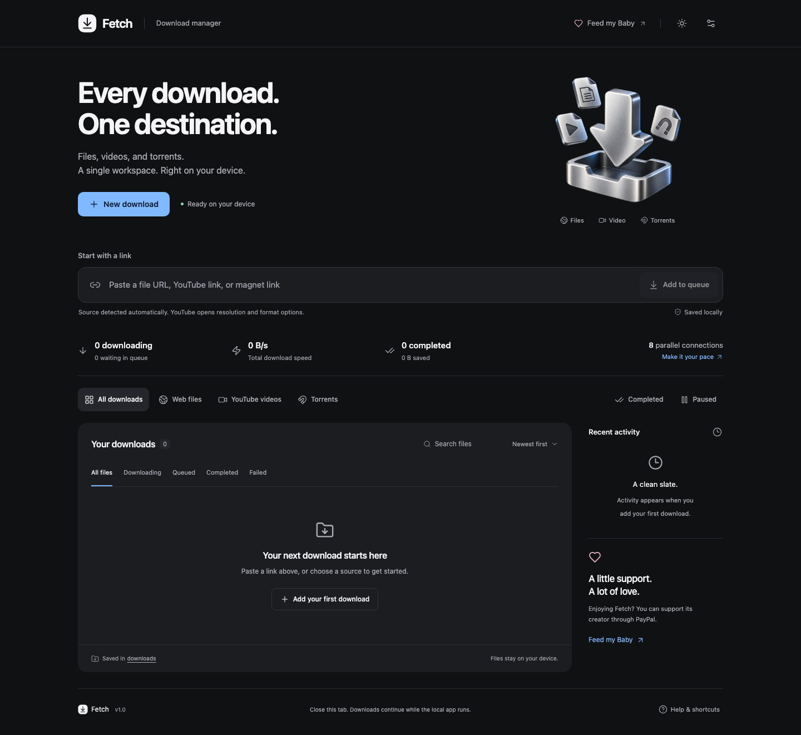
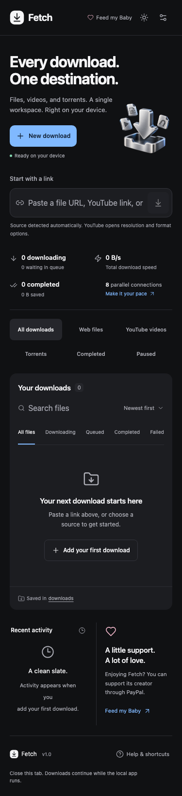

# Fetch — All-in-One Download Manager

**Save files, videos, and music from one simple app.**

Fetch is like a delivery desk for files. Give it a link, and it brings the download to your computer. You can save files from websites, choose the quality and file type of a YouTube video, save only its sound, or download a torrent.

You open Fetch in your browser, but the app works on your own computer. Its dark screen is the default; a button lets you switch to a light screen. You can pause a download, continue it later, or let extra downloads wait their turn.

For a large web file, Fetch can ask for several smaller parts at the same time. Think of several helpers carrying different parts of a box. This can help when the website allows it. It cannot make your internet connection faster than its limit.

Think of Fetch as a delivery desk with three doors:

| Door | What comes through it | Example |
| --- | --- | --- |
| **Web files** | Files available through a direct web link | A ZIP archive, PDF, installer, or disk image |
| **YouTube** | An available YouTube video's picture and sound | Choose a maximum resolution through 4K, a video file type, or sound only |
| **Torrents** | Files shared through the BitTorrent network | A Linux distribution shared by its publisher |

You use the same dashboard for all three. You do not need a different control panel for each kind of download. Fetch now opens in dark mode, with a light-mode switch in the header, a silver interactive illustration, and motion that respects your browser’s reduced-motion preference.



## Start here

This GitHub repository contains the app's code, screenshots, instructions, and tests. **The app runs locally on your computer.** Uploading its code to GitHub does not turn it into a website that downloads files for everyone.

“Local” means the control panel and download service run on your device. They still connect to websites, YouTube, and torrent peers to receive the files you request.

The app has been tested on **macOS with Node.js 24**. The installation instructions below use macOS and Homebrew. Other systems need equivalent download engines installed; they have not been verified in the recorded test run. In particular, YouTube pause/resume uses Unix process signals, so Windows needs additional platform work before that behavior can be relied on.

## What Fetch can do

| Feature | Plain-language explanation |
| --- | --- |
| Three download types | Add a web link, YouTube link, magnet link, or torrent file |
| Parallel web downloads | Ask for several parts of one file at the same time |
| A waiting queue | Let extra downloads wait until a download slot is free |
| Pause, resume, cancel, and retry | Control unfinished downloads or try again after a failure |
| Saved settings and history | Remember your choices and download records across restarts |
| Search and filters | Find a file by name or link, or show one source or status |
| Live progress | See received bytes, speed, status, and an estimated time remaining |
| Download details | Inspect the source, output files, connections, and actual completed torrent/web pieces |
| Separate output folders | Keep different jobs with the same filename from overwriting one another |
| Responsive dashboard | Use the control panel in a wide or narrow browser window |

The dashboard starts empty. Its progress numbers come from actual downloads, not example animations or pretend files.

## How parallel downloads work

Imagine you need to bring home a large box of blocks. One helper can carry the whole box. Eight helpers can each carry part of it.

Fetch uses a similar idea for web files:

1. The file server identifies which bytes belong to the file. A **byte** is a tiny unit of data.
2. If the server supports **byte ranges**, Fetch can ask for particular sections of the file.
3. The download engine requests several sections at once.
4. It writes the received sections into their correct places in the final file.

For example, a large file could be requested in several pieces rather than one long request. The exact piece boundaries and number of busy connections are chosen by the download engine.

Fetch starts with **8 parallel connections per web file**. You can choose **1 to 16** in Settings. Think of each connection as a lane carrying part of the file.

### Will it always be faster?

No. Extra lanes help only when the road and the destination can use them.

A server may limit each connection, so several connections can sometimes receive more data together. But your internet connection still has a maximum capacity. A server can also limit the combined speed or refuse extra connections.

Small files do not need many sections. Some websites do not support byte ranges at all. In those cases, the engine uses a suitable single-file transfer instead. Parallel downloads cannot create bandwidth or guarantee a fixed speed increase.

## Install and open the app on macOS

You need four main tools:

| Tool | Its job |
| --- | --- |
| **Node.js and npm** | Run the app and install its JavaScript packages |
| **aria2** | Download web files and BitTorrent files |
| **yt-dlp** | Find and download available YouTube media |
| **FFmpeg** | Combine separate picture and sound files, or convert sound to MP3 |

FFmpeg also includes **ffprobe**, which the live tests use to inspect finished media files. Use Node.js **22 or newer**; Node.js 24 was used for verification. Fetch explicitly enables Node as yt-dlp's JavaScript runtime.

1. Install the tools. This command assumes Homebrew is already installed:

   ```sh
   brew install node aria2 yt-dlp ffmpeg
   ```

2. Copy this repository to your computer:

   ```sh
   git clone https://github.com/rakidoodle/fetch-download-manager.git
   cd fetch-download-manager
   ```

   If the repository is private, GitHub must recognize an account that has access to it.

3. Install the app's packages:

   ```sh
   npm ci
   ```

4. Start Fetch:

   ```sh
   npm run dev
   ```

5. Open **[http://localhost:4317](http://localhost:4317)** in your browser.

“Localhost” means **this computer**. Keep the terminal process running while you want Fetch to download. Press **Ctrl+C** in that terminal to stop it.

### Run the prepared production build

The development command is convenient while editing the code. A production build prepares the interface for ordinary use:

```sh
npm run build
npm start
```

Open the same local address afterward. “Production build” here means a prepared local version; it does not publish the app to an online hosting service.

## Download your first file

For a quick download, paste a link into the long link field and click **Add to queue**. Fetch recognizes direct file links, supported YouTube links, and magnet links.

For more options, click **New download** and choose a source.

### Web files

1. Choose **Web file**.
2. Paste a direct `http://` or `https://` file URL.
3. Click **Start download**.

A **direct file URL** leads to the actual file, rather than a page containing a download button. If you paste an ordinary web page, Fetch may receive that page instead of the file you intended.

Links with embedded usernames or passwords are rejected. There is no browser-cookie import, custom request-header editor, or login flow for protected download websites.

### YouTube videos and audio

1. Choose **YouTube**.
2. Paste a YouTube video URL.
3. Select a quality and click **Start download**.

Choose **Video** or **Audio only** first. Then choose an output format. Video also offers a separate maximum resolution.

| Setting | Available choices |
| --- | --- |
| **Video resolution** | Best available, up to 2160p/4K, 1440p/QHD, 1080p, 720p, 480p, 360p, 240p, or 144p |
| **Video format** | MP4, WebM, or MKV |
| **Audio format** | MP3, M4A, FLAC, WAV, or Opus |

MP4 is a familiar choice for most devices. WebM uses matching WebM streams when the source provides them. MKV can hold different video/audio codecs without changing the selected source codecs. A **codec** is the method used to store the picture or sound.

MP3 is widely supported. M4A stores compact AAC audio. Opus is efficient for modern players. FLAC stores audio without further lossy compression, but cannot bring back detail missing from the source. WAV stores uncompressed audio and can create larger files.

In audio mode, the resolution field is disabled because sound has no video pixel height. The app uses the best available audio source. A small output summary shows the choices before you start.

YouTube often provides picture and sound as separate streams. Fetch downloads them and lets FFmpeg combine them. During this work, the status can change to **Processing**. Wait for **Completed** before saving the result.

A requested quality is a limit, not a promise that the source contains that exact resolution. Video downloads target the chosen container. MP4 prefers suitable source streams and uses FFmpeg conversion where needed; WebM requires matching streams; MKV remuxes the selected source codecs. Audio is extracted or converted to the chosen audio format. The finished output is checked before the app reports completion.

Playlists are disabled. Private, deleted, restricted, login-required, unavailable, or DRM-protected videos can fail. There is no account sign-in or cookies interface. YouTube changes can also require a newer version of yt-dlp.

### Torrents

You can use any of these inputs:

- A **magnet link**: an address that identifies a torrent using its digital fingerprint.
- An `http://` or `https://` URL whose path ends in `.torrent`.
- An uploaded **`.torrent` file**, up to **5 MB**.

A torrent is a set of instructions for finding and checking shared files. It is not the finished download itself.

The engine finds **peers**, which are other computers participating in the transfer. A **seeder** is a peer with the complete data. Some torrents also offer **web seeds**, which are web servers supplying the same data.

With a magnet link, Fetch first obtains **metadata**: information such as the file names, sizes, and piece fingerprints. Then it downloads the payload. “Finding peers and torrent metadata” is normal during that first stage.

aria2 checks torrent pieces against their expected hashes. A hash is like a fingerprint for a piece of data: the received piece should match the expected fingerprint.

Fetch downloads **all files included in the torrent**. It enables DHT and peer exchange, which help peers find one another. It stops seeding once the job finishes. BitTorrent can share pieces while a download is active; the control panel being local does not make a torrent transfer anonymous.

There is no torrent file-selection screen, long-term seeding control, or ratio-management feature. A torrent with no available peers or web seeds cannot finish until a source becomes available.

## Understand the controls

| Control or status | What it means |
| --- | --- |
| **Queued** | Waiting for an available download slot |
| **Downloading** | Receiving data, finding sources, or fetching media information |
| **Processing** | Combining or converting downloaded YouTube media |
| **Paused** | Stopped temporarily; you can resume it |
| **Completed** | The engine finished the job and its files are available |
| **Failed** | The engine reported a problem; open details to read the error |
| **Canceled** | The job was stopped; partial files are kept |
| **Retry** | Try a failed or canceled job again, reusing partial data where the engine and source allow it |
| **Remove from history** | Remove the record from the dashboard while leaving its files on disk |

Click a download's name to open its details. Finished single-file jobs offer a **Save file** button. Finished torrents with several files list those files separately in their details.

The save button copies the already downloaded file through your browser. Your browser decides where to put that copy. The original remains in Fetch's download folder.

Time remaining is an estimate based on the reported speed. It may change when a connection slows down, more peers appear, or YouTube starts another media stream.

## Tune the settings

| Setting | Default | What changing it does |
| --- | --- | --- |
| **Parallel connections** | `8` | Sets 1–16 connections for newly started web jobs and newly started YouTube fragment downloads |
| **Simultaneous downloads** | `3` | Sets 1–8 active jobs; extra jobs wait in the queue |
| **Speed limit** | `0` | Sets a rate in KiB/s; `0` means unlimited |

**KiB/s** means kibibytes per second. One kibibyte is 1,024 bytes. It measures how much data can arrive each second.

The speed limit applies to web and torrent downloads together immediately. It applies separately to each newly started YouTube job. It is not one combined cap across all three engines.

Changing the connection count does not rebuild an already started transfer. Lowering the active-job limit lets current jobs finish before another queued job begins. Pausing a job frees its active slot for another job.

## Where your files and settings live

```text
fetch-download-manager/
├── downloads/
│   └── <unique-job-id>/      Files belonging to one download
└── .data/
    └── state.json           Saved history, progress, and settings
```

Each job gets a unique folder. That keeps two unrelated downloads named `file.zip` from sharing the same output path.

aria2 and yt-dlp may also create partial files or small control files. These help remember which data has already arrived. Leave them in place if you want to resume unfinished work.

The saved state is written to a temporary file and then moved into place. This reduces the chance of leaving a half-written state file during a normal save. It is not a backup system.

The `downloads/` and `.data/` folders are excluded from Git. Publishing this repository does not upload your download history or the files you have downloaded through the app.

### Closing, stopping, and restarting

- **Close the browser tab:** downloads continue while the local server is running.
- **Stop the server:** unfinished jobs are saved as paused during a normal shutdown.
- **Restart the server:** reopen Fetch and resume the jobs you want to continue.
- **Resume a supported source:** the engine can reuse its partial files. A web server without range support may need to start that file again.
- **Cancel or remove a record:** files remain on disk. Delete unwanted files using your operating system's file manager.

A sudden power loss or forced crash can interrupt the latest state save. The recorded recovery test covers a controlled server stop and restart, not every possible system failure.

## What stays local, and what uses the network?

The interface, history, settings, and downloaded outputs live on the computer running Fetch. There is no hosted Fetch account service or remote storage service in this app.

The app contacts the sources you choose. A website or torrent peer can see the connection information normally involved in a download. The interface uses your system fonts and serves its artwork from the project. It does not need a separate font service.

The server listens on `127.0.0.1`, so the control panel is intended for access from the same computer. It checks the request's host and origin and uses a fresh per-run key for changes. In plain language, it checks which page is asking and requires a matching key before accepting download-control commands.

Completed-file requests resolve the real file path and only serve files inside that job's directory. A moved or deleted output file produces an error.

This is a **single-user local app**. It does not include remote accounts, internet-facing authentication, malware scanning, or a VPN. Do not expose its API through a public proxy. Download only content you are authorized to access.

## Common problems

| Problem | What to check |
| --- | --- |
| The page cannot connect | Start `npm run dev` or `npm start`, and keep that terminal running |
| A download engine is missing | Install aria2, yt-dlp, and FFmpeg, then restart Fetch |
| A web file is slow | Try another connection count; check server limits and your internet capacity |
| A torrent is waiting | It needs reachable peers or web seeds; a magnet also needs metadata |
| YouTube download fails | Read the job's error, check that the video is available, and update yt-dlp if needed |
| A saved file cannot be opened from the app | Check whether its original output was moved or deleted on disk |

For Homebrew installations, update the video engine with:

```sh
brew upgrade yt-dlp
```

If port `4317` is already used by another program, choose another local port:

```sh
PORT=4320 npm run dev
```

Then open `http://localhost:4320`.

## How the app is built

The browser is the control panel. The local server is the coordinator. The engines do the download work.

```text
You paste a link into the React interface
                 |
                 v
The Express server checks it and adds a job
                 |
        +--------+---------+
        |                  |
        v                  v
      aria2              yt-dlp
  Web + torrents         YouTube
        |                  |
        |                  v
        |                FFmpeg
        |            Merge or convert
        +--------+---------+
                 |
                 v
     Files saved on your computer
                 |
                 v
     Status returned to the dashboard
```

**React and TypeScript** build the interface. **Vite** prepares its browser files. **Express** exposes the local API. The download manager coordinates jobs and writes saved state. It controls aria2 through a password-protected local JSON-RPC connection and runs yt-dlp as a separate process.

On Unix systems, YouTube pause, resume, and cancel signal the process group so media-processing child processes are controlled too.

| Path | What to find there |
| --- | --- |
| `src/` | Dashboard interface and visual styling |
| `server/` | Local API, engine control, queue, and saved state |
| `tests/` | Backend and browser tests plus controlled download fixtures |
| `scripts/test-live.mjs` | Real YouTube video/audio verification |
| `artifacts/` | Screenshots and the recorded verification report |

### Optional environment settings

Most users do not need these. Developers can change them before starting the server:

| Variable | Default | Purpose |
| --- | --- | --- |
| `PORT` | `4317` | Local control-panel/API port |
| `FETCH_DATA_DIR` | Project's `.data` folder | Where saved state is written |
| `FETCH_DOWNLOAD_DIR` | Project's `downloads` folder | Where output files are stored |
| `ARIA2_BIN` | `aria2c` | aria2 executable name or path |
| `YTDLP_BIN` | `yt-dlp` | yt-dlp executable name or path |

## Tests and verification

A test is a repeatable check that asks, “Did the app do what we expected?”

The recorded verification run on **14 October 2026** passed:

| Check | Recorded result |
| --- | --- |
| TypeScript check and production build | Passed |
| Backend tests | **25 passed, 0 failed** |
| Production browser tests | **12 passed, 0 failed** |
| Real YouTube 720p video with audio | Passed; output streams inspected with ffprobe |
| Real YouTube pause/resume | Passed |
| Real YouTube MP3 conversion | Passed; MP3 stream inspected with ffprobe |
| Production-package security audit | 0 known vulnerabilities reported by npm at the time |

The web tests compare downloaded bytes with the original bytes. The torrent tests use a real TCP peer and tracker. The magnet test exchanges real torrent metadata. These checks exercise the engines rather than drawing pretend progress bars.

Nine media-adapter tests run real yt-dlp and FFmpeg against short locally generated clips. They inspect all three video containers and all five audio formats with ffprobe, and check that a missing source reports failure. They do not bypass the public API’s YouTube-host validation.

The tests also cover servers without ranges, redirects, tiny files, queue limits, pause/resume, cancellation, retries, missing resources, truncated responses, history removal, file-path containment, origin/key/host checks, and normal restart recovery.

Browser tests click the actual interface and check file saving, dialogs, keyboard focus, errors, search, filters, sorting, torrent uploads, magnets, settings, layouts at 390, 768, and 1440 pixels wide, theme persistence, the confirmed PayPal link, independent YouTube resolution/format submission, and keyboard/reduced-motion artwork behavior.

### Run the local checks

Install Playwright's test browser once:

```sh
npx playwright install chromium
```

Then run:

```sh
npm run check
```

This builds the app, runs backend tests, and runs browser tests. Browser tests start their own production server on port `4318` and save test data under `.data/browser-*`. They do not control your ordinary review downloads. Use a free port `4318` when running them.

To run one group separately:

```sh
npm run build
npm test
npm run test:browser
```

### Run the real YouTube checks

```sh
npm run test:live
```

This separate command requires internet access and downloads roughly 55 MB of public Blender Foundation media, plus conversion output. It tests 720p video, pause/resume, and MP3 conversion. Its temporary download files are removed when the script finishes normally.

Live checks depend on an outside service. A video becoming unavailable, YouTube changing its behavior, or your connection failing can change the result.

Passing these tests is useful evidence. It does not prove that every remote server, video, torrent swarm, crash, or future engine update will work without a bug.

Read the [recorded verification report](artifacts/VERIFICATION.md) for more details.

## Preview on a narrow screen



The layout adjusts to a smaller browser window. The app's server and download engines still run on the computer hosting it; opening the layout at a mobile-sized width does not make Fetch a native phone app.

## Appearance and support

Fetch starts in dark mode unless this browser has a saved light-mode preference. Use the sun or moon button in the header to switch. The choice is saved in your browser, independently of the server’s download settings.

The silver download sculpture responds to mouse movement. You can also focus it and press the left/right arrow keys or activate it to rotate. Its source buttons open a new download with the selected source. If reduced motion is enabled, decorative movement stops and the task controls remain available.

The **Feed my Baby** link opens [the creator’s PayPal page](https://www.paypal.com/paypalme/ruffytrinidad) in a new tab. You choose what to do there. No payment is automatically made by Fetch.

The custom brand icon and favicon are SVG files. The generated illustration is an optimized WebP with transparency. The visual reference is Apple’s restrained product craft; Fetch is an independent app.

## Engine documentation

For the full technical details of the tools doing the download work:

- [aria2 manual](https://aria2.github.io/manual/en/html/aria2c.html)
- [yt-dlp documentation](https://github.com/yt-dlp/yt-dlp)
- [FFmpeg documentation](https://ffmpeg.org/documentation.html)
